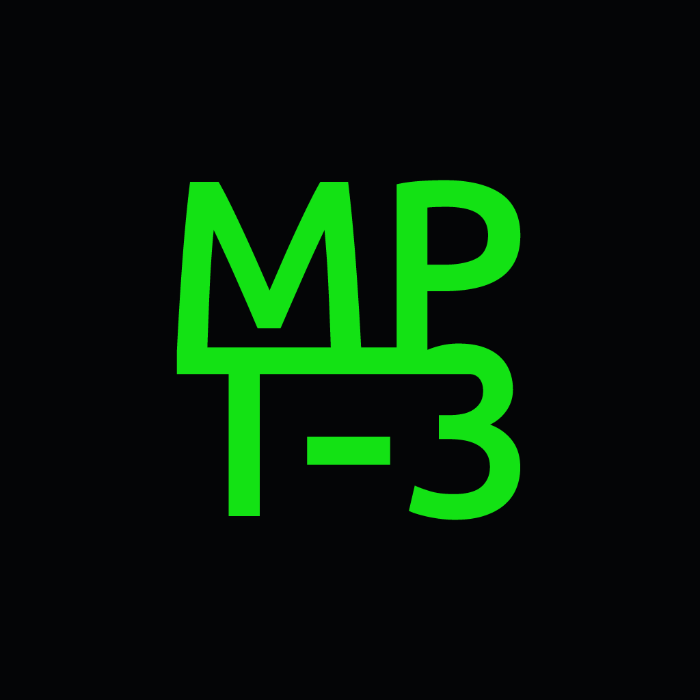
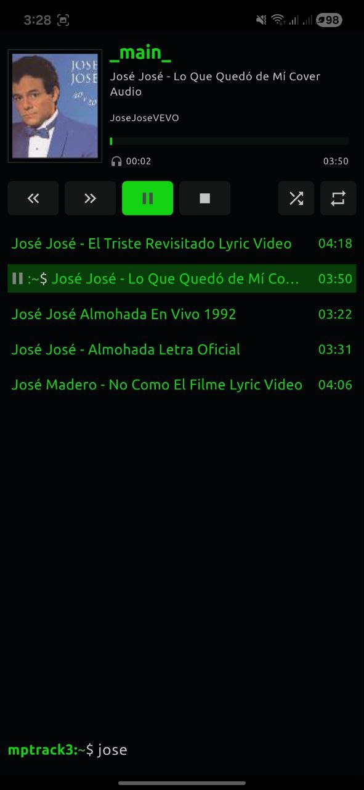
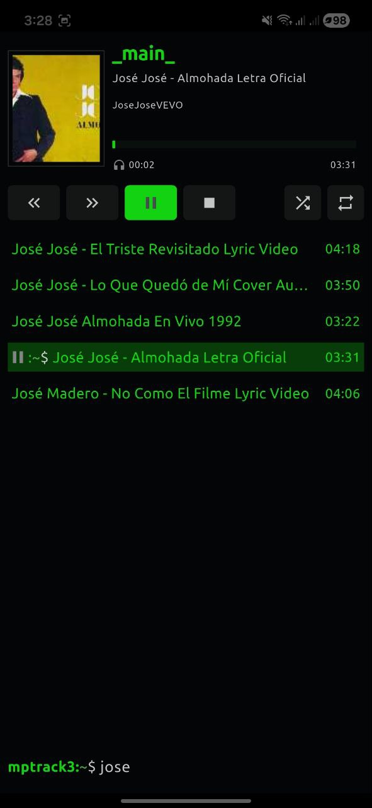

# Mptrack3 🎧

**Mptrack3** es un reproductor de música local potente y minimalista desarrollado con Flutter. Diseñado para ofrecer una experiencia de audio premium, gestiona eficientemente la biblioteca del dispositivo y garantiza una reproducción ininterrumpida mediante servicios de audio en segundo plano.

  

---

## ✨ Características Principales
* **Biblioteca Local:** Escaneo automático de archivos de audio en el almacenamiento interno y SD.
* **Segundo Plano (Background Service):** La música no se detiene al cerrar la app o bloquear el teléfono.
* **Control de Notificaciones:** Manejo de reproducción desde el centro de control y pantalla de bloqueo.
* **Gestión de Arte:** Visualización automática de carátulas y metadatos de las pistas.

---

## 🛠️ Stack Tecnológico

El rendimiento de **Mptrack3** se basa en la combinación de tres potentes motores de audio y un gestor de estado reactivo:

### 1. [on_audio_query](https://pub.dev/packages/on_audio_query)
Es el encargado de la base de datos. Se comunica con las APIs nativas del sistema para consultar y organizar toda la música disponible, permitiendo filtrar por artistas, álbumes y géneros sin afectar el rendimiento de la UI.

### 2. [just_audio](https://pub.dev/packages/just_audio)
El motor de reproducción de alta fidelidad. Es responsable de la decodificación del audio, el manejo de la lista de reproducción (playlists), el control de volumen y la navegación entre pistas (seek/skip) con latencia mínima.

### 3. [audio_service](https://pub.dev/packages/audio_service)
La pieza clave para una experiencia profesional. Esta librería envuelve a `just_audio` en un servicio de fondo, permitiendo que el sistema operativo reconozca a Mptrack3 como un reproductor activo, habilitando los controles externos y manteniendo el proceso vivo aunque la app no esté en primer plano.

### 4. [Provider](https://pub.dev/packages/provider)
Utilizado para la gestión de estados global. Sincroniza la posición de la barra de progreso, el estado de pausa/play y la información de la canción actual en todas las pantallas de la aplicación.

---

  

  

